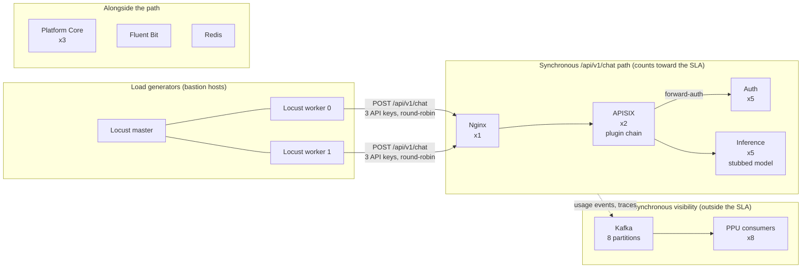

# AI4I Orchestrate performance tests

Load tests for the AI4I orchestration layer on `POST /api/v1/chat`, run with [Locust](https://locust.io) against a stubbed model.

**Objective:** optimise each component on the `/api/v1/chat` path so the latency the orchestration layer adds stays within **10 ms, at more than 1,000 RPS**. The stub is assumed to add no latency, so measured end-to-end latency is treated as AI4I overhead, a deliberately conservative upper bound.

## Perf testing summary

On the final setup, the path sustained **1,240 RPS for 2 hours** (8.9M requests, 0.00% failures), 24% above the 1,000 RPS requirement.

| Metric       | Result | Against the 10 ms SLA                       |
| ------------ | ------ | ------------------------------------------- |
| Median (P50) | 11 ms  | within 1 ms of it                           |
| Average      | 15 ms  | 5 ms above it                               |
| P95          | 40 ms  | tail behaviour only, not the SLA            |
| P99          | 86 ms  | tail behaviour only, not the SLA            |

Full analysis: [docs/report.md](docs/report.md).

## Environment details

Load is generated by distributed Locust (one master, two workers) against the full gateway path. The model is a stub.



| Layer          | Setup                                                                       |
| -------------- | --------------------------------------------------------------------------- |
| Cluster        | 2 x m6a.2xlarge CPU nodes, 2 x m6a.large system nodes (non-burstable)       |
| Replicas       | Auth 5, Inference 5, Platform Core 3, APISIX 2, Nginx 1                     |
| Kafka (PPU)    | 8 consumer pods, 8 partitions                                               |
| Load generator | distributed Locust, master + 2 workers (single m6a.xlarge before 5 Aug)     |
| Request        | fixed heavy "turn 20" payload, `stream=False`, round-robin over 3 API keys |

More detail: [docs/environment.md](docs/environment.md). The diagram shows the components named in the report. Where Platform Core sits relative to the request path is not drawn, because the test data does not say.

## Benchmarking details

| Doc                                       | What it covers                                                                                                                                                 |
| ----------------------------------------- | -------------------------------------------------------------------------------------------------------------------------------------------------------------- |
| [docs/report.md](docs/report.md)           | Findings and the steps taken to improve performance (plugins, Auth, Inference, Platform Core, Nginx, infrastructure, distributed run, Kafka) |
| [docs/methodology.md](docs/methodology.md) | SLA definition, what is measured, request behaviour, and where each number came from                                                                           |
| [docs/environment.md](docs/environment.md) | System under test, infrastructure, and how to run the tests                                                                                                    |

## Quick start

Read [Test prerequisites](docs/environment.md#test-prerequisites) first: you need a deployed stack with a stubbed model, a registered service ID and three API keys.

```bash
python3 -m venv .venv && . .venv/bin/activate
pip install -r locust/requirements.txt
cp locust/.env.example locust/.env      # fill in the host, service ID and 3 API keys (never commit .env)

scripts/run_single.sh 20 1 2m           # users, spawn rate, run time
```

Distributed runs: see [docs/environment.md](docs/environment.md#running-the-tests).

## Repository layout

```
docs/      report.md, methodology.md, environment.md
locust/    chat_load.py, config.py, payloads/chat_turn20.json, requirements.txt, .env.example
scripts/   run_single.sh, run_distributed.sh
runs/      reported run data (CSV)
```

## Notes

- Only `/api/v1/chat` is covered. Runs that show a progression are reported, and failed runs were test defects and are ignored.
- Sections 4.1, 4.2 and 4.5 of the report came from separate isolated-hop scripts that are not in this repository. See [docs/methodology.md](docs/methodology.md#where-the-numbers-came-from).
- The request payload and behaviour are fixed. Changing them invalidates the reported numbers.
